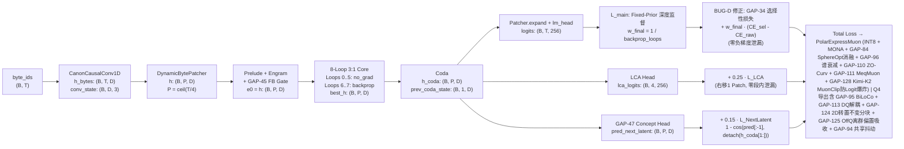
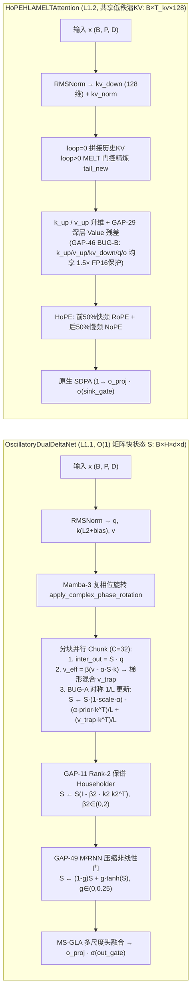
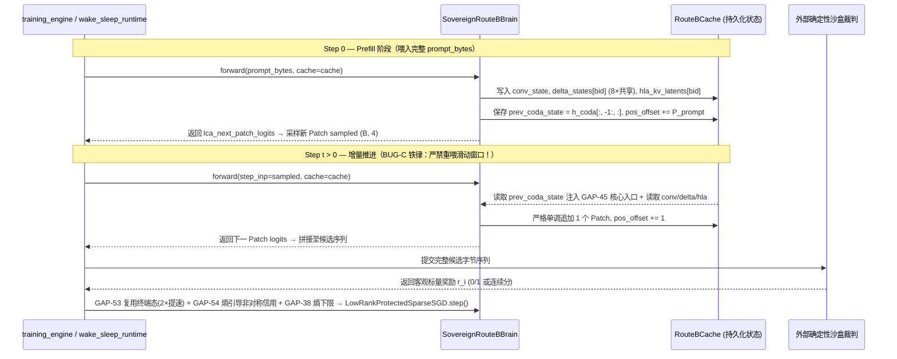
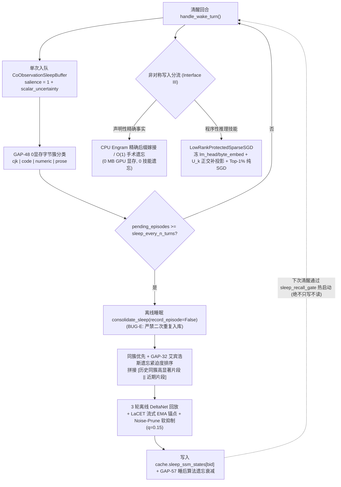
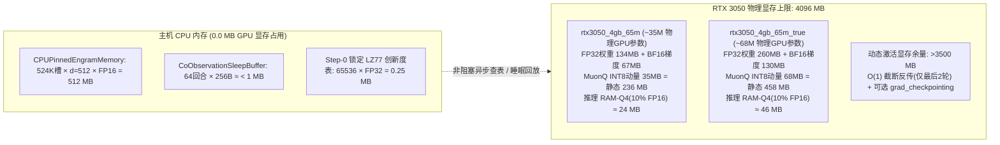
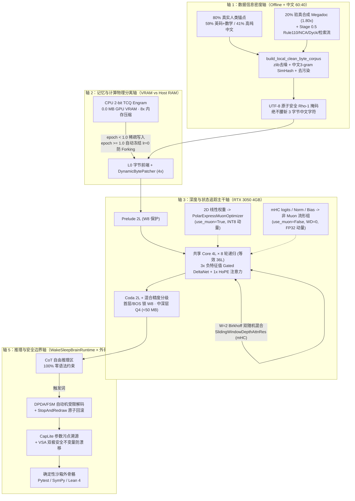

# Sovereign AI Brain (Route B v10.32) — 活体纯文本工程架构图总览（Mermaid）

> **设计原则**：全套工程图均采用 **纯文本 Mermaid + Markdown 精确对照表**，严禁静态二进制位图。随架构演进同步修改、支持 Git 逐行 Diff，并在 GitHub / VS Code / Obsidian 等 Markdown 环境中原生渲染。

---

## 图 1：全系统拓扑（L0–L4 纯 AI 大脑 × 外骨骼三接口 × 确定性 Harness）

```mermaid
flowchart TB
    subgraph L0["L0 字节感知与动态分块前端 (src/brain/sovereign_brain_pytorch.py)"]
        IN["原始字节流 byte_ids (B, T) ∈ [0..255]"] --> EMB["byte_embed + CanonCausalConv1D (k=4)"]
        EMB --> PATCH["DynamicBytePatcher (4×步长)<br/>Step-0 锁定 LZ77 表 (65536项) + ATDC 门控"]
    end

    subgraph PRE["L1 Prelude + L2 三元神经调质 + L3 0显存外置冷记忆"]
        PATCH --> PL["Prelude: 2× OscillatoryDualDeltaNet"]
        PL --> NM["TernaryNeuromodulator (<0.01M)<br/>ACh(探索) / NE(增益) / DA(写入)"]
        PL --> ENG["L3 CPUPinnedEngramMemory (CPU RAM, 0 MB VRAM)<br/>524K槽 4头哈希 + DA稀疏CPU-SGD<br/>精确后缀嫁接(GAP-17) + O(1)手术遗忘(GAP-40)"]
    end

    subgraph CORE_BOX["L1 共享 3:1 循环核心 × T=8 轮 (等效深度 36 层)"]
        FB["GAP-45 全带宽潜态入口反馈 (e0=h 之前)<br/>h ← h + tanh(latent_fb_gate) · shift(h / prev_coda_state)"]
        CTRL["循环控制器: Parcae + GAP-50 OrthoInj正交注入(ACh)<br/>RMSNorm隐式增益 + ATF随机探索(NE) + GAP-51 自适应深度先验<br/>GAP-61 mHC-Birkhoff双随机流 + GAP-63 ELR循环进度条件 + OASIS Softmax_1 (W=2) + GAP-52 8×终端共享快权重<br/>v9.0-v9.2活体: SGA-Sparse(75-85%) + GateFloor(SiLU+delta降28阶梯度炸) + GroupClip(FP64防静默丢20%步) + BitNest(0MB) | EpiLoRA + TAC-CoT(潜/工具交替降6.8x前向)"]
        DN["75% — 3× OscillatoryDualDeltaNet (L1.1)<br/>Mamba-3梯形+复相旋转 + GDN-2对称1/L擦写<br/>Rank-2保谱Householder + GAP-49 M²RNN + GAP-76 PH惊奇 + GAP-87 KalmaNet岭分母 + GAP-90 SLA块动量 + GAP-89 ReWY三乘反传<br/>GAP-78/88 持久缩放+浅层FP16防反馈爆炸 LoReS状态量化 + GAP-91 Bole因子化树推测(降82-99×显存)<br/>MS-GLA多尺度衰减 + Wake←Sleep回传门 + GAP-157 MERLIN二阶矩路由 + GAP-162 SuPER-Mamba惊奇路由"]
        HLA["25% — 1× HoPEHLAMELTAttention (L1.2)<br/>共享低秩HLA潜KV (kv_down→k_up/v_up, d=128)<br/>MELT跨轮门控 + 深层Value残差(GAP-29)<br/>HoPE + Qwen门 + GAP-56 Hadamard-INT4 + GAP-104 RecSA + GAP-105 LoopVQ + GAP-112 ActKV + GAP-127 DeepSeek-V4 CSA/HCA + GAP-129 Gemma局部全局KV + GAP-130 Nemotron-H混合层率 + GAP-132 FlatCake一次性写平铺KV + GAP-143 NVIDIA Dynamo/Reshard热更与KV路由 + GAP-146 ML Drift阶段内核与Gemma4 PLE + GAP-147 NVFP4 16元素微块随机舍入 + GAP-148 TPU256对齐GDN与LatentMoE + GAP-153 SGLang三路径NVFP4-KV + GAP-154 FA4方阵量化与零填充Jagged + GAP-156 BCG可打断CUDA图 + GAP-158 ParaTTT 32x并行深层TTT + GAP-159 ResidualQuant 2-bit循环KV(-80.7%) + GAP-160 E8-QAT隐式格2-bit + GAP-161 CoTS竞争潜推理 + GAP-163 Select-TTT查询快权 + GAP-165 INT8精确4.26-bit块GEMM(RTX3050原生) + GAP-166 PACT并行认证提交 + GAP-169 BridgeKV跨模型KV缝合<br/>v9.0活体: GateSightKVPruner(1/10 KV) + BOS Summary(零参放宽Sink)<br/>v9.1-v9.2服务: Fairway双车道 + PrefixCacheMetastabilityBudgeter(防70m崩溃) + cμ + CISA分块索引稀疏(1M降8-16x KV读)"]
        HALT["L2 元认知早停与测试时扩展<br/>T-LoopFormer冻结 + FPRM早停 + GAP-62 Consilience自确定性 + GAP-67 ICS + GAP-126 Slim-SC冗余思维链剪枝<br/>LoopSpec+Saguaro+AMTP/Nightjar+GAP-114 SwitchSD隐态复制意图路由+GAP-75 EigenTrack + GAP-82 过思考早停护栏"]
        FB --> CTRL --> DN --> HLA --> HALT
        HLA -. "r = 1..8 (前6轮 no_grad, 后2轮反传/ckpt)" .-> CTRL
    end

    ENG --> FB
    NM -. "ACh / NE / DA" .-> CTRL

    subgraph OUT_BOX["L1 Coda 与三头输出"]
        HALT --> LCD["GAP-92 LoopCD-Hidden 活体早/末轮隐态对比精炼<br/>h ← h_R + α(h_R - h_early) (零输出头开销)"]
        LCD --> CODA["Coda (k=2) → 保存 cache.prev_coda_state + GAP-101 EchoMoE增量参考压缩(-58%)"]
        CODA -. "t-1 连续思维潜态反馈" .-> FB
        CODA --> LM["1. lm_head: 精确离散字节 NTP (256类)"]
        CODA --> LCA["2. LCA 并行4字节解码头 (GAP-07)"]
        CODA --> NLP["3. GAP-47 next_latent_pred 概念预测头<br/>(余弦对齐, 规避 PIPO 纯连续坍缩)"]
    end

    subgraph EXO["外骨骼生理桥 (src/brain/exoskeleton_bridge.py) → Harness (src/harness/)"]
        BR1["接口 I: Aleatoric(H) / Epistemic(JSD) + 分裂共形拒答 + 抗从众守卫"]
        BR2["接口 II: DLE 不可伪造 256字节帧 (0x11/0x12 特权指令数据隔离)"]
        BR3["接口 III: 非对称写入口 (事实→CPU Engram | 技能→LowRankProtectedSparseSGD GAP-80谱方向 + GAP-93 <0.05%删权 + GAP-107 UUE零空间对跖遗忘 + GAP-102 LWS版本化权重 + GAP-109 KVGuard块影子安全)"]
        HAR["确定性外骨骼 Harness: GAP-97 无人值守双探针门控 / GAP-98 Sentry / GAP-99 VeriHarness / GAP-119 PPMF溯源防火墙 / GAP-123 Σ-Mem信度记忆 / GAP-131 多轮安全漂移守卫 + GAP-133 LEASH三级安全门控 + GAP-134 ToolRoute工具健康遥测 + GAP-135 安全主控多脑治理 + GAP-137 OwlSight全景CoT脱敏监控 + GAP-141 Codex分层沙箱解析前DNS门控 + GAP-142 性能工厂对抗反事实闭环 + GAP-144 Anthropic脑手解耦与金库代理 + GAP-145 OpenAI前向域分层Linter + GAP-150 Anthropic两阶段推理盲分类器 + GAP-151 NVIDIA PAIR局域网路由与OpenShell + GAP-152 Google全会话旁路异常检测<br/>GAP-83/85/86/106/115/116/120/121/122 KAPPO+BRAT+VIGOR方差分配+PAEC决策熵+aTTT反重复TTT / GAP-117 逐位确定性归约 / GAP-100/108/118 三模态+RRR+WMT分层保留记忆"]
        BR1 & BR2 & BR3 --> HAR
    end

    LM & LCA & NLP --> BR1 & BR2
    HAR -. "验证后事实 / 技能梯度" .-> BR3
    BR3 -. "O(1)事实写删" .-> ENG

    subgraph DATA_SEC["v9.0-v9.1 预训练数据反投毒 (ADR-013) × 外骨骼安全与跨精度审计 (ADR-012)"]
        D_CLEAN["prepare_seed_corpus.py (活体)<br/>Mixture-then-Select + RCE预训练投毒清洗(拦截0.0005%后门)<br/>LOOM留一法去噪 + GRAFT牺牲适配器 + GroupLevelSyntheticCurator<br/>v9.3活体: Host-Aware域名配额 + Nemotron-CC-Math-v1/Code-v3 + PT/MT×LR协同退火"]
        SEC_GATE["外骨骼硬护栏 (src/experimental/harness_and_safety_policies.py)<br/>Soteria形式化规划验证(1.7x零违规) + TenonAgent沙盒内存虚拟化(8.6x)<br/>QHijackCrossPrecisionAuditGate(跨精度配对审计) + Airlock(DAG最小割零泄漏) + PRISM(-78.3% MCP权限) + ContinualHarnessRegressionGuard(防-66%遗忘) + EVOLVE + GovernedExperimentAppendOnlyLedger(全量实验账本) + MemShift(确定性派生修复) + Plan-and-Patch(局部计划修补2x) + ShapleyCompactMemoryPruner(80%剪枝)"]
    end
    D_CLEAN -.->|"洁净字节语料"| IN
    CORE_BOX -->|"动作/适配器审计"| SEC_GATE
```



---

## 图 2：单步前向精确张量形状与多目标训练损失流



---

## 图 3：`OscillatoryDualDeltaNet`（75%）与 `HoPEHLAMELTAttention`（25%）内部算子图



---

## 图 4：增量解码与 RLVR 自博弈 `RouteBCache` 时序图（含 BUG-C 约束）



---

## 图 5：清醒–睡眠双相共现固化与非对称防遗忘闭环（含 BUG-E 约束）



---

## 图 6：RTX 3050 4GB 显存 vs. CPU 内存物理预算（代码实测口径）



### 关键模块与工程不变量速查表

| 器官 / 文件 | 核心张量 / 状态 | 代码锚点 | 已锁死工程不变量 |
| :--- | :--- | :--- | :--- |
| `OscillatoryDualDeltaNet` | `S: (B, H, d, d)` | `src/brain/sovereign_brain_pytorch.py` | 对称 `1/L` 分块更新 (BUG-A) + `M²RNN` 压缩非线性门 (GAP-49) + Rank-2 保谱 |
| `HoPEHLAMELTAttention` | `c_kv: (B, T_kv, 128)` | `src/brain/sovereign_brain_pytorch.py` | `k_up/v_up/kv_down/q_proj/o_proj` 1.5× RAM-FP16 保护 (BUG-B) + 显式因果掩码 |
| `SovereignRouteBBrain` | `delta_states[bid]`, `prev_coda_state` | `src/brain/sovereign_brain_pytorch.py` | GAP-45 入口反馈 + GAP-50 `OrthoInj` 正交注入 + GAP-52 `8×` 终端快权重共享 |
| `AdaptiveDepthPriorController` | `logits[2..8]` (0 MB VRAM) | `src/brain/training_engine.py` | GAP-51 熵正则动态深度先验，杜绝固定深度破坏终端 KV/快权重共享 |
| `rlvr_grpo_self_play_step (GAP-66 RoAR + GAP-68 QAE + GAP-69 RL-ZVP + GAP-73 PSPO + GAP-79 p=0.5课程)` | `step_inp: (B, 4)` | `src/brain/training_engine.py` | 增量缓存仅喂新采样 Patch (BUG-C) + 自适应策略熵下限 (GAP-38) |
| `run_pretrain_stage` | `w_final = 1/backprop_loops` | `src/brain/training_engine.py` | 选择性 Token 损失精确配权，零负梯度泄漏 (BUG-D) |
| `WakeSleepBrainRuntime` | `record_episode=False` | `src/brain/wake_sleep_runtime.py` | 清醒触发睡眠严禁重复入库 (BUG-E) + 字节簇路由 (GAP-48) |
| `ModeHoppingCheckpointSelector` | `ood_gen_acc / id_loss` (0 MB VRAM) | `src/brain/training_engine.py` | GAP-136 预训练 System-1/2 模式跳跃峰值检查点锁选（禁用盲目权重平均） |
| `DreamingMemoryConsolidator` | `<=200行/25KB顶层索引` (0 MB VRAM) | `src/brain/wake_sleep_runtime.py` | GAP-138 Anthropic做梦日志纠偏 + 单写者分片Wiki + 防博尔赫斯膨胀 |
| `ZeroTIMThreeWayPolicyContract` | `Decode==Prefill==Trainer` (0误差) | `src/brain/training_engine.py` | GAP-139 Google Zero-TIM三路逐位对齐 + TiTO多轮ID透传 |
| `StreamingDiLoCoFragmentScheduler` | `P=N_layers+1` (`1/P`流式同步) | `src/brain/training_engine.py` | GAP-140 Google MaxText流式DiLoCo（降65×流量、零周期停顿） |
| `MultiTurnInTurnToolRLOOEngine` | `<|tool_response>` 轮内续写 + RLOO | `src/brain/training_engine.py` | GAP-149 Google Tunix多轮Agentic RL（前缀缓存不破+精确Token连续性） |
| `FlexShardMuonAndCollectiveFreeCkptPlanner` | `BlockShard_2D_Owned` + 去集合保存 | `src/brain/training_engine.py` | GAP-155 TorchTitan FlexShard Muon(-79%耗时) + 34ms无阻塞检查点 |
| `GPPOGeneralizedDivergenceRL` | `{f-Div × Estimator}` 信赖域 | `src/brain/training_engine.py` | GAP-164 广义散度RL统一PPO/GRPO/DAPO（+50%数学/+14%代码） |
| `HintedScalingLawForecaster` | `AUHC` 渐进提示扩展律 | `src/brain/training_engine.py` | GAP-167 噪声底线下扩展预测（误差21pp→4.3pp） |
| `TRUERErrorAwareRewardRectifier` | 冻结纠错整流器 | `src/brain/training_engine.py` | GAP-168 拦截TTRL多数投票假阳性奖励 |
| `LLM42VerifiedSpeculationDeterminism` | 非确定快路径+固定批验证回滚 | `src/brain/sovereign_brain_pytorch.py` | GAP-170 SOSP 2026 保留动态批吞吐的确定性推理 |
| `KernelSeekQuestionDrivenLoop` | 极简外壳+决策提问 CUDA 迭代 | `src/brain/sovereign_brain_pytorch.py` | GAP-171 单文件零依赖 CUDA 达 1.16× FA3 / 1.46× FA4 |
| `LARKSegmentedKernelProofGate` | Lean 4 分段 GPU 内核证明门 | `src/brain/sovereign_brain_pytorch.py` | GAP-172 实接 Ref [705]，验证 PyTorch 等价并拦截数据竞争 |
| `MEMENTOCompactionAndBacktrackingController` | 20K 窗口上限+置信回溯折叠 | `src/brain/wake_sleep_runtime.py` | GAP-173 20K 上下文处理 2.5M 长书，8B 模型 36.9%→67.8% |
| `YoloFSStagedSnapshotFilesystem` | 暂存快照+渐进权限可撤销 FS | `src/brain/exoskeleton_bridge.py` | GAP-174 SOSP 2026 防护 Agent 破坏性文件误操作 |
| `HarnessFlowMCTSOptimizer` | MCTS 外壳演进树（UCB1） | `src/brain/exoskeleton_bridge.py` | GAP-175 6 基准 +10.89pp / +3.95pp over Meta-Harness |
| `MultiAgentInfoNetworkGuardrail` | 错位信息传染与哑铃拓扑禁令 | `src/brain/exoskeleton_bridge.py` | ⛔负向禁令（arXiv:2611.11714）目标错位时阻断全透明 peer 传染 |
| `HelionCompileTimeIRHeuristicPlanner` | 编译期 IR 启发式内核配置 | `src/brain/sovereign_brain_pytorch.py` | GAP-176 PyTorch Helion 替代慢速运行时穷举自动调优 |
| `OPSDWeightTextMemoryRouter` | OPSD 权重+文本验证回退路由 | `src/brain/wake_sleep_runtime.py` | GAP-177 权重记忆高置信直出、低置信回退文本检索 |
| `TrainingFreeMemoryLifecycleGate` | UCB 归因 + 合并保全门控 | `src/brain/wake_sleep_runtime.py` | GAP-178 +11.92pp recall@5，0/100 合并丢失，写入零额外调用 |
| `KnowinglyWrongBeliefConsistencyGuard` | 信念冲突致错位红线守卫 | `src/brain/wake_sleep_runtime.py` | ⛔负向禁令（arXiv:2611.05287）阻断无证据强行违背信念更新 |
| `LPropLatentUncertaintyBeliefReviser` | 潜空间不确定度信念修正 | `src/brain/sovereign_brain_pytorch.py` | GAP-179 免额外轨迹采样修正继承信念，token 消耗最低 |
| `SafeStartFullExpertPrefixGuard` | MoE Prompt+前8词全专家护栏 | `src/brain/sovereign_brain_pytorch.py` | GAP-180 保留 >=85% 稀疏加速并消除越狱顺从飙升 |
| `DeadlineAwareReasoningBudgetGate` | 价值-截止时间联合快慢路由 | `src/brain/exoskeleton_bridge.py` | GAP-181 ⛔负向禁令 防止并发突增下思考模式超期坍塌（79.2%→1.4%） |
| `AEGISOnlineSDCSelfEquivalenceSensor` | 重计算 xorsum 静默损坏感知 | `src/brain/sovereign_brain_pytorch.py` | GAP-182 OSDI 2026 0.86% 开销在线拦截静默数据损坏（SDC） |
| `GateSightGDNAnticipatedKVPruner` | GDN 信号预判释放 90% 注意力 KV | `src/brain/sovereign_brain_pytorch.py` | GAP-183 专为混合 GDN+Attention，零注意力分数领先 KVzip +9.5~47.2 分 |
| `BitNestSharedWeightSpeculator` | 位嵌套共享权重推测解码 | `src/brain/sovereign_brain_pytorch.py` | GAP-184 95.2% 接受率、零额外草稿显存（4GB RTX 3050 绝配） |
| `TaSQOneBitKVSpaceTailor` | RoPE 兼容 1-bit KV 协方差 VQ | `src/brain/sovereign_brain_pytorch.py` | GAP-185 SGLang 14× 批大小、1.87× 峰值吞吐 |
| `SchemaFillSlotParallelToolDecoder` | 工具调用多槽位并行推测验证 | `src/brain/exoskeleton_bridge.py` | GAP-186 Glaive/BFCL 端到端工具调用提速 4.05× |
| `DIADisagreementHeterogeneousArbiter` | 阶段分歧触发异构独立仲裁 | `src/brain/exoskeleton_bridge.py` | GAP-187 ⛔负向禁令 替代同模型相关误差自洽（+7.0% MuSiQue，省 47.2% token） |
| `StagQDyadicMultiPrecisionStream` | 单流 2-bit+1-bit 二进多精度权重 | `src/brain/sovereign_brain_pytorch.py` | GAP-188 单流前缀可读，2-bit MMLU 领先 +3.1~7.0 分 |

| `GateSightKVPruner` + `BOS Summary` | `src/brain/sovereign_brain_pytorch.py` | 活体已接电 (v9.0) | 直读 GDN 隐态释放 90% 注意力 KV + Prefill 放宽 BOS 掩码削弱 Sink 垄断（零额外参数） |
| `RouteBBlock` (`SGA-Sparse`) + `bitnest_spec_decode` | `src/brain/sovereign_brain_pytorch.py` | 活体已接电 (v9.0) | 原生 SwiGLU 75–85% 门控稀疏 + `0.0 MB` 额外草稿显存位嵌套推测解码 |
| `prepare_seed_corpus.py` (`ADR-013`) | `src/brain/prepare_seed_corpus.py` | 活体已接电 (v9.0) | `Mixture-then-Select` 两阶段组合选样 + RCE 预训练投毒触发器清洗门控 |
| `Soteria` + `TenonAgent` + `QHijackCrossPrecisionAuditGate` | `src/experimental/harness_and_safety_policies.py` | Phase 3 阶段已落地 (v9.1) | 形式化规划验证零违规 + 沙盒内存虚拟化 8.6× 超售 + 跨精度配对审计拦截量化残差劫持 |
| `EpiLoRA` + `Fairway` + `PrefixCacheMetastabilityBudgeter` + `cμ` | `src/experimental/kernel_and_serving_planners.py` | Phase 3 / Scale-Up 已落地 (v9.1) | LoRA epilogue 融合省 16-bit 副本 + 双车道 Prefill 防 p99 饥饿 + 驻留 KV 挂起防亚稳态崩溃 |
| `ShapleyCompactMemoryPruner` | `src/experimental/memory_and_sleep_planners.py` | Phase 3 阶段已落地 (v9.1) | 无训练查询无关 Monte Carlo Shapley 80% 端侧记忆 token 剪枝 |
| `GateFloor` + `group_clip_grad_norm_` (`GroupClip`) | `src/brain/sovereign_brain_pytorch.py` & `training_engine.py` | 活体已接电 (v9.2) | `SiLU(z)+delta` 压低近零嵌入梯度爆炸 28 个数量级 + FP64 解耦嵌入裁剪根治静默丢 20% 训练步 |
| `Airlock` + `PRISM` + `ContinualHarnessRegressionGuard` + `EVOLVE` | `src/experimental/harness_and_safety_policies.py` | Phase 3 已落地 (v9.2) | 多智能体血缘 DAG 最小割隔离零泄漏 + 反事实最小 MCP 权限 + 防外骨骼跨任务自演进灾难性遗忘 |
| `CISA` + `TAC-CoT` | `src/experimental/kernel_and_serving_planners.py` | Phase 3 已落地 (v9.2) | 免稀疏训练 1M 上下文分块索引降 8–16× KV 读 + 潜推理与显式工具交替降 6.8× 前向 |
| `score_and_prioritize_hosts` + `Nemotron-CC-Math-v1/Code-v3` | `src/brain/prepare_seed_corpus.py` | 活体已接电 (v9.3) | 域名质量抽样深度配额抓取 + 133.3B LaTeX 数学与 Code-v3 直通预训练底盘 |
| `compute_coupled_pt_mt_lr_schedule` | `src/brain/training_engine.py` | 活体已接电 (v9.3) | PT/MT 数据混合与 LR 退火协同设计：严格等高纯度 MT 进入后再启动衰减 |
| `GovernedExperimentAppendOnlyLedger` + `MemShiftDeterministicRepairRouter` + `FtF` | `src/experimental/` | Phase 2/3 已落地 (v9.3) | 独立控制面仅追加实验账本 + 派生记忆确定性重算路由 + SAE 特征极小样本选样 |
| `PlanAndPatchLocalRepairPlanner` | `src/experimental/harness_and_safety_policies.py` | Phase 3 扩展储备 (v9.4) | 锁定前缀/后缀原地局部修补长程计划（修复成功率 53.7% vs AR 27.0%，延迟 -39~46%） |
| `ReplaySSMCheckpointBuffer` + `TransactionalKVStateGuard` | `src/brain/sovereign_brain_pytorch.py` & `exoskeleton_bridge.py` | 活体已接电 (v10.32) | ReplaySSM+DeltaLog O(1) 指针回滚与防震荡熔断 + 物理 KV/SSM 原子事务回滚堵死 25/63 跨分支残影泄漏 |
| `LTTuningConfidenceSwitch` + `KernelRidgeAttentionChallenger` + `get_eval_suite_manifest` | `src/brain/` & `src/experimental/` | 活体+PK挑战者 (v10.32) | 置信度动态潜/显式切换防 Shortcut 坍缩 + KRA 递归核岭非线性记忆 OU 自由度恢复 + 补齐最后 5% 评测与工具清单 |
| `EarlyLayerW8QuantGuard` + `StopAndRedrawLoopBreaker` + `GuidedRLVRLogicController` + `VerifierYoudenAuditGate` | `src/brain/` | 活体已接电 (v10.32) | 极浅层0.34% W8保精度(+42.92pp) + 零训练复读重抽熔断 + 高熵边界引导扩4×方差 + Youden指数防99.9%裁判作弊 |
| `GPUAdaptiveSpecWidthController` + `ROSESubspaceRiskMask` + `AbstentionDirectionTriRouter` | `src/brain/` | 活体已接电 (v10.32) | 全GPU零回读自适应树宽(3.5–8.6×) + 正交风险掩码防千次更新遗忘 + 残差流三轴几何拒答(追问/查Engram/拒绝)与自适应粒度 |
| `FOSCARAffineFoldKVKernel` + `WriteGatedKVAdmission` + `TurnWiseCreditAssigner` + `ToolUpdateIntegrityGate` | `src/brain/` & `src/experimental/` | 活体已接电 (v10.32) | 仿射折叠低比特KV核(91.3% HBM) + 写前KV准入(-46–68%) + 多轮扣减累计奖励防冗余窃信用 + 工具SHA-256防更新投毒 + System2→0程序蒸馏 + B3双块重叠去噪 |
| `LoopSkimMultiDepthVerifier` + `ShallowWriteAnchorExtractor` + `CVSAZeroDenseCoverageGate` + `SpectralUnlearningMuonUpdater` + `DISCERNReadTimeResolver` + `ExecutableFSMProcedureGuard` | `src/brain/` & `src/experimental/` | 活体已接电 (v10.32) | 循环浅层无损推测验证 + 写读不对称锚点直灌KV + Layer0强稠密闭环覆盖门 + Muon谱遗忘 + 写时保留读时消解防错删 + 可执行FSM流程强控 |


## 图 7：五大正交解耦全融合架构与 8 组跨机制冲突物理隔离图（v10.32 终极洁净拓扑）



## 图 8：65M 生命周期四段接力与 Stage 4 OPD-GRPO 动态路由状态机

```mermaid
stateDiagram-v2
    [*] --> PreFlight: CrossMechanismInterferenceMatrixGuard (8 组冲突强阻断)
    PreFlight --> Stage05: 通过预检 (safe=True)
    Stage05: Stage 0.5 算法预预训练 (0.18B tok)
Rule 110 / 2D NCA / Dyck / 长程检索
    Stage05 --> Stage1: 激活检索与状态追踪回路
    Stage1: Stage 1 主预训练 (8.5B tok / 130x TPP)
中文 60:40 + 80% 真实锚点
epoch=1.0 冻结 CPU Engram 防 Forking
    Stage1 --> Stage2: 停在 >400x 遗忘悬崖之前
    Stage2: Stage 2 退火与扩窗 (1.0B tok -> 16K)
lr_ratio >= 0.20 黄金窗口注入
出版教材 + Diff + 10% 对齐先验 + 5% PPT 回放
    Stage2 --> Stage3: 克制 SFT (0.10B tok)
中英自然对话 + CoT + 工具调用
    Stage3 --> Stage4_Cold: 进入 Stage 4 RLVR 自博弈
    Stage4_Cold: 通过率 < 15%
λ_opd=0.80 / λ_grpo=0.20
OPSD 自蒸馏 + LUFFY/Scaf-GRPO 破零方差
    Stage4_Cold --> Stage4_Handoff: 通过率 15% ~ 30%
线性平滑退火交接棒
    Stage4_Handoff --> Stage4_RL: 通过率 > 30%
λ_opd=0.15 / λ_grpo=0.85
Dr.GRPO + 客观验证器冲上限
    Stage4_RL --> Stage4_Clamp: 通过率 > 66.7%
自动开启 Metis-1.6 长度奖励防反转夹钳
    Stage4_Clamp --> [*]
```


## 图 9：全仓库 4 大核心模块热路径控制器总装图（ADR-001~013 双向强同步）

```mermaid
flowchart LR
    subgraph M1["sovereign_brain_pytorch.py — 主干算子与 KV/量化控制器"]
        S1["ByteFlowAMOREntropyGateController · QDeltaCCQEraseReadController"]
        S2["SPARECompactRecurrentStateProjector · QEDTailReplayHybridController"]
        S3["DecodeFeedbackKVEvictionTimer · VerKVFathomCertificateFetcher"]
        S4["SynLatSyntaxAlignedCompressor · LoopMTPFixedLNSScheduler · LoopedFactorScalingVaSEGuard"]
        S5["SpectralGuardCHONHotChannelShield · AutomataEigenStateAndTCQEngramGuard"]
    end

    subgraph M2["training_engine.py — TrainingEngineGovernanceSuite 统一训练治理"]
        T1["TrainingEngineGovernanceSuite · CrossMechanismInterferenceMatrixGuard"]
        T2["SmallModelGRPOBreakthroughController · NGramForkingAndMetisClampGuard"]
        T3["QUASAROnlineSaliencyQATUpdater · APEX4MixQuantMuonHyperballGuard · MuonPlusMSignRankOptimizerGuard"]
        T4["TVPDRealSpeculativeLossScheduler · TACOOpeNormOneSparseUpdater"]
        T5["InfoGRPODoubleRolloutEstimator · MarginProximalEntropyRLVRController · CueGRPOVerifierAnchoredCredit · VeriGateAsymGRPOEngine · FRPOFutureKLOARCreditEngine"]
    end

    subgraph M3["wake_sleep_runtime.py — 醒睡记忆固化与同步遗忘"]
        W1["UMASMultiAgentUncertaintyGate · LMMRDeltaProceduralMemoryBridge"]
        W2["TFRNetDriftGuardMemoryRuntime · RepSelectISMSchemaUnlearnRuntime · SBUSAGOSynchronizedUnlearnRuntime"]
    end

    subgraph M4["exoskeleton_bridge.py — 外骨骼工具授权与防注入安全边界"]
        E1["HostSecondaryToolAuthGuard · MCPProviderBindingAndOverServeGuard · HardwareKeystoreSkillGuardEnforcer"]
        E2["StoredPISafeMCPKernelFuzzGuard · MCPSHIELDOwnerHarmAnumatiGuard"]
        E3["TriggerAutomatonAndCapLiteGuard · HolographicInvariantVSAGuard"]
    end

    M1 --> M2
    M2 --> M3
    M3 --> M4
```


